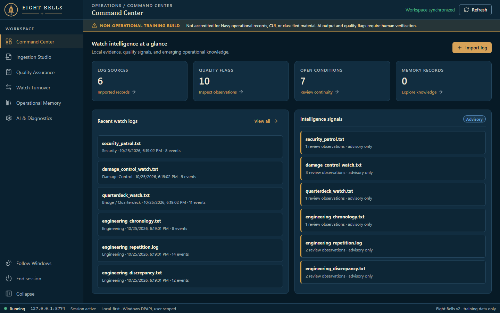
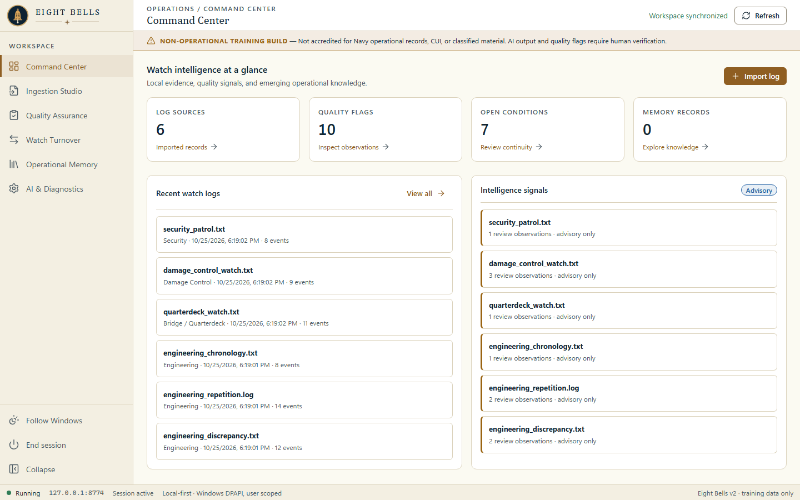

<p align="center">
  <picture>
    <source media="(prefers-color-scheme: dark)" srcset="assets/brand/emblem-dark-transparent.png">
    
  </picture>
</p>

# Eight Bells

Local-first watchstanding log intelligence: quality review, evidence-linked turnover and lessons learned (v2).

## The name

Eight bells is rung at the change of the watch. Eight Bells supports watch relief and turnover: it helps the relieving watchstander see what is open, what changed, and where the evidence is. Formerly LogHawk.

**Status:** Windows-first engineering prototype, **not accredited** for sensitive or operational data. **Use synthetic, non-sensitive training logs only.** The system does not replace authoritative watch records, qualified watch relief, or approved procedures.

Eight Bells ingests log text and structured exports, highlights possible quality deficiencies, drafts watch turnover, preserves event histories, and supports evidence-linked lessons learned.

| Night watch (dark) | Chart room (light) |
| --- | --- |
|  |  |

Eight Bells follows the Windows light/dark setting by default; the theme button in the sidebar switches between Follow Windows, Night watch and Chart room. The screenshots show only the synthetic fixtures in [samples](samples/README.md), captured by `docs/screenshots/capture-landing.js` against an isolated test server.

## Quick start (Windows)

1. Clone: `git clone https://github.com/fleethacker-data-crucible/Eight-Bells.git`
2. Double-click **`Launch-EightBells.bat`** (the old `LogHawk.bat` name still works and forwards to it). This starts a hidden PowerShell 5.1 service, selects a free localhost port on the same bound socket, opens your browser with a temporary session token, and shows a startup status.
3. Use **`EightBells-CLI.bat`** for an interactive terminal with diagnostics and the same GUI.
4. Closing the Eight Bells tab stops the server on its own (about 5 s after the tab closes, or 20 s after the last heartbeat). Use **End session** in the sidebar to stop it immediately.

### Session lifecycle

- **Tab owns the server.** The open tab sends `POST /api/heartbeat` every 5 s and a `navigator.sendBeacon` leaving signal when it closes. The server stops 20 s after the last heartbeat, or 5 s after a leaving signal with no newer heartbeat; a reload or a second tab keeps it running. A request that is still running (save, import, AI call) always finishes first.
- **One instance.** Launching again while Eight Bells (or an older LogHawk build) runs asks *stop it and start fresh?*. `Launch-EightBells.bat --replace` answers yes; `Launch-EightBells.bat --stay` keeps the server running after the tab closes. Both options also work with `EightBells-CLI.bat` and `Launch-LocalDev.bat` (or `-Replace` / `-Stay` on `Start-EightBells.ps1`).
- **Off switch.** Set `EIGHTBELLS_AUTO_STOP=0` in the environment to turn auto-stop off (Eight Bells has no env/config file). The former `LOGHAWK_AUTO_STOP` is still read when `EIGHTBELLS_AUTO_STOP` is not set.
- **Stop from the shell.** `powershell.exe -NoProfile -ExecutionPolicy Bypass -File .\Stop-EightBells.ps1` stops every running Eight Bells server without knowing its PID, including one started by an older LogHawk build.
- **Runtime file.** Each server writes `%LOCALAPPDATA%\EightBells\logs\eightbells-server-<pid>.json` (pid, port, url, startedAt; never the session token) beside its existing store, and deletes it on stop. `-LocalDev` uses `%LOCALAPPDATA%\EightBells-LocalDev\logs`. The launcher and `Stop-EightBells.ps1` also look for `loghawk-server-<pid>.json` under the former `%LOCALAPPDATA%\LogHawk(-LocalDev)\logs`, so a server started by an older build can still be found and stopped. Stale files (dead pid) are removed.

Process-scoped `-ExecutionPolicy Bypass` is used only to launch the script without changing machine policy. It cannot override Group Policy, AppLocker, or WDAC restrictions.

### Try sample files

Browse the synthetic fixtures under [samples](samples/README.md).
- `engineering_normal.log` — routine entries without expected quality flags.
- `engineering_discrepancy.txt` — unresolved equipment condition.
- `engineering_repetition.log` — suspiciously repeated content.
- `engineering_chronology.txt` — out-of-sequence timestamp.
- `readings.csv` — actual CSV header/row parsing.
- `elog_export.json` — actual JSON event parsing.
- `noisy_ocr.txt` — transcription corruption.
- `form_watch.html` — printable simulated paper form, suitable for a synthetic photograph.

## Implemented in v2

| Capability | Implementation |
| --- | --- |
| Local server | Loopback-only raw TCP HTTP service (no HttpListener, URLACL or administrator requirement) |
| Launch | Process-only execution policy; GUI/background and visible CLI launchers; OS-assigned port |
| Session | Random per-process bearer token in browser URL fragment; authenticated API; Host and Origin checks |
| Storage | User-scoped Windows DPAPI encrypted store under `%LOCALAPPDATA%\EightBells\store.v2.dpapi` (copied forward once from `%LOCALAPPDATA%\LogHawk` if present) |
| Formats | Text/LOG/Markdown, structured CSV and JSON, pasted transcriptions |
| Images | Local preview; manual transcript or explicit opt-in remote vision transcription (PNG/JPEG/WebP, 2MB max) |
| PDF | **Manual transcription only; no PDF extraction engine** |
| Quality | Timestamp regression, configurable reading interval gaps, copy-forward candidates, missing dispositions |
| Evidence | Source line references for entries and quality findings |
| Review | Append-only-in-application reviewer dispositions, explanations and timestamps |
| Turnover | Offline deterministic draft with source line references, suspected unresolved conditions |
| Memory | Local searchable log/lesson store, recurring equipment candidates across separate logs |
| AI | Manually configured OpenAI-compatible chat endpoint, optional key held **in process memory only** |
| Privacy | No remote calls unless manually configured and explicitly authorized for each AI request |
| Diagnostics | Local service logs (excluding log content and AI keys), GUI diagnostics and status |
| Testing | Node parsing QA regression tests and Windows PowerShell 5.1 authenticated service smoke test |

**Important qualifiers:** "Append-only-in-application" is not tamper-proof; users with filesystem/control of the same Windows account may still affect the store. DPAPI protects data at rest for a Windows user, **not** cross-account sharing, administrator compromise, or enterprise access control. The application has no identity proofing for the person marking a lesson "reviewed." AI outputs are not automatically approved or trusted.

## Data boundaries

- The encrypted database is in the user's local AppData directory, not the Git repository.
- Upgrading from LogHawk: on first launch, if `%LOCALAPPDATA%\EightBells` does not exist and `%LOCALAPPDATA%\LogHawk` does, the old folder is copied forward (after any running LogHawk has been stopped, and without its runtime files). The original `LogHawk` folder is left untouched; delete it yourself once you have confirmed your records in Eight Bells. `EIGHTBELLS_*` environment variables are read first, with the former `LOGHAWK_*` names as a fallback.
- The original imported text is stored within the encrypted record; **image files themselves are not stored**. The user must review and save their transcription.
- Exporting JSON explicitly creates an **unencrypted** file. Handle or remove exported files appropriately.
- Old `data/records.json` from v1 is **not automatically migrated**; it remains an unencrypted legacy file and should not contain sensitive data.
- The server listens only on `127.0.0.1`; network access to other workstations is not enabled.
- No background or automatic AI analysis is performed.

## AI configuration

> **Intelligence router:** the manual AI provider will move behind the Fleet intelligence router, [Fairlead](https://github.com/fleethacker-data-crucible/Fairlead), so Eight Bells defaults to the router instead of a hand-entered endpoint. Until then the manual settings stay as they are. See [TechStack](TechStack), "Intelligence router".

Go to **AI & Diagnostics**, enter a specific approved HTTPS `/chat/completions` endpoint (or HTTP loopback for a local model), model name and optional session-only bearer key. The AI path expects OpenAI-compatible JSON response structure. Lazarette credentials are **not integrated in this build**; do not copy production secrets into an unapproved environment. Vision transcription requires a model that accepts image_url data payloads. Every request requires affirmative consent at the point of use.

## Testing

Windows:
```powershell
powershell.exe -NoProfile -ExecutionPolicy Bypass -File .\tests\Smoke-Test.ps1
```

Node.js:
```bash
node tests/engine.test.js
node tests/lifecycle.test.js
```

The GitHub Actions workflow validates PowerShell syntax, fixture parsing, and an isolated Windows end-to-end smoke flow. CI should be checked before claiming a Windows build is verified.

## Outstanding for controlled operational deployment

Dedicated electronic-log adapters, offline OCR, secure shared-device identity/RBAC, interoperable Lazarette credential vault integration, approved SQLCipher backend, immutable audit chain, file-based original-document vault, model governance and evaluation, records retention, accreditation and cyber authorization. These are explicit engineering requirements, not claimed completed features.

See [docs/ARCHITECTURE.md](docs/ARCHITECTURE.md) for architecture, security boundaries and roadmap.
