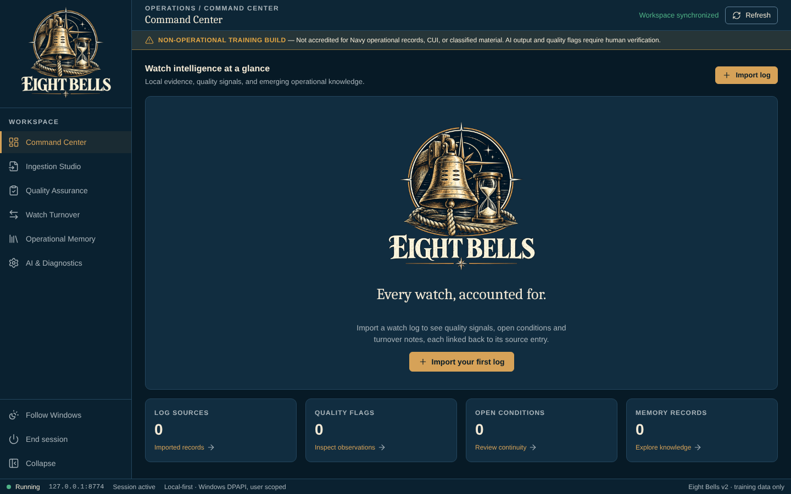
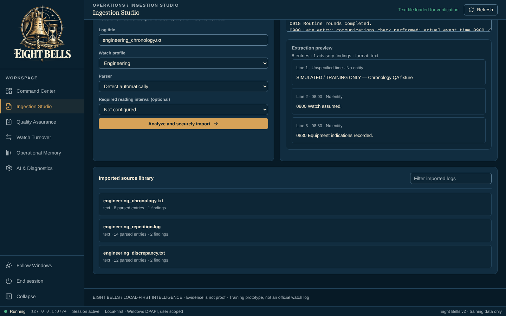
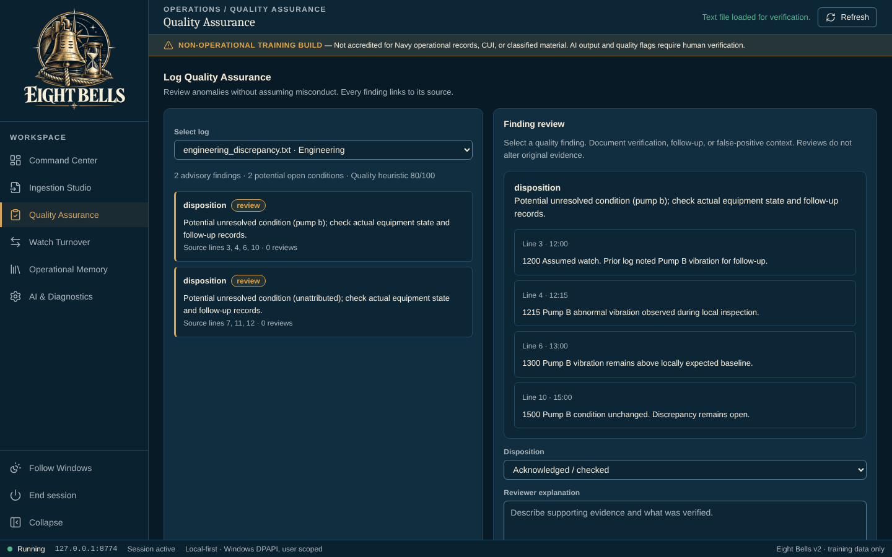
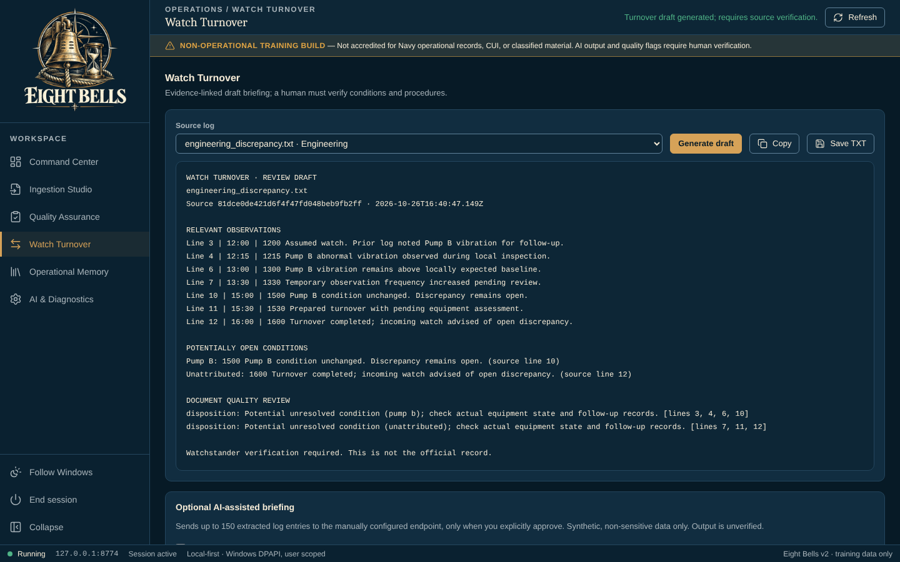
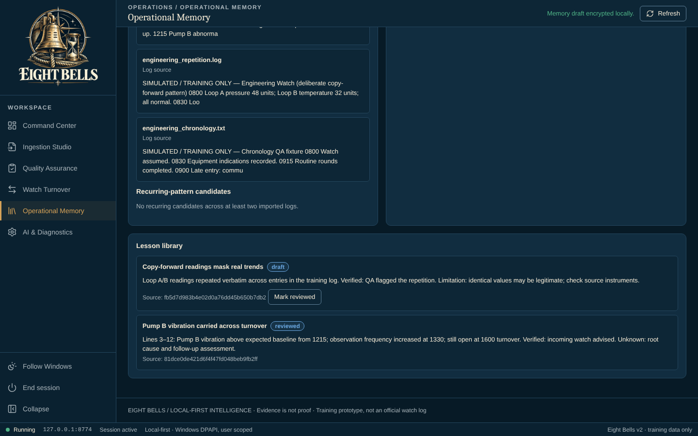
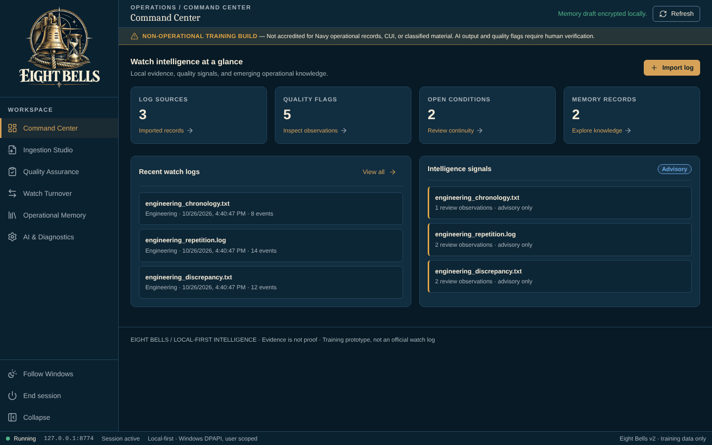
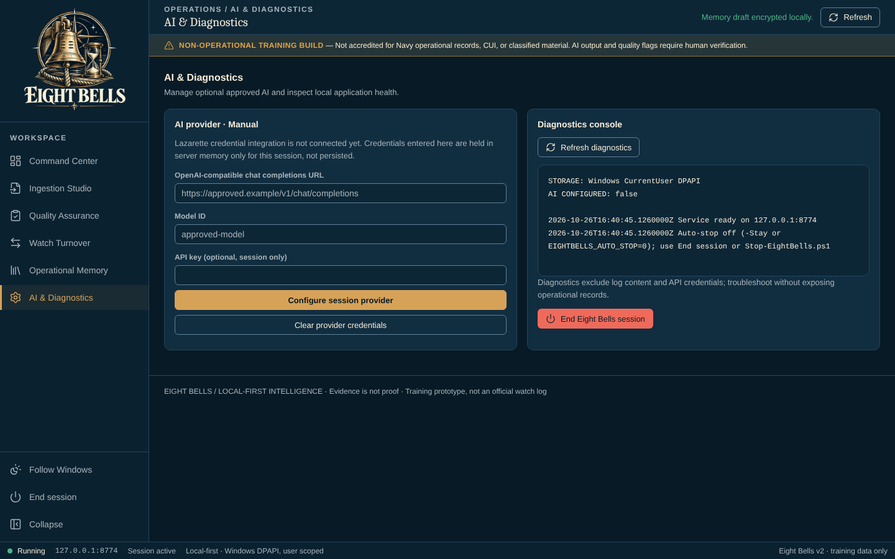

# Eight Bells walkthrough

Import watch logs, review their quality, and build an evidence-linked turnover for the relieving watchstander.

> **Status: skeleton.** The screenshots below are placeholders. Zombie Admin captures them with demo data, and the Chief of Staff scans them for sensitive content before they are added (team directive 10). Until then the image links do not resolve.

## Before you start

- Windows PowerShell 5.1 (part of Windows). No administrator rights and no installer.
- Microsoft Edge or Google Chrome.
- Launch: Double-click `Launch-EightBells.bat` (starts a local PowerShell 5.1 service and opens the browser).
- Synthetic, non-sensitive training logs only. Samples are in `samples/`.

## Steps

### 1. First launch

Eight Bells opens on the **Command Center**, empty until you import logs.

### 2. Import logs

In **Log Ingestion Studio**, add log files. Text, CSV and JSON exports are parsed.

### 3. Review quality

**Log Quality Assurance** flags unresolved conditions, repeated content and out-of-sequence times.

### 4. Build the turnover

**Watch Turnover** lists what is open and what changed, each linked to its evidence.

### 5. Keep lessons learned

**Operational Memory** keeps lessons learned across watches.

### 6. See it at a glance

The **Command Center** now summarizes the watch.

### 7. AI and diagnostics

**AI & Diagnostics** holds the optional AI endpoint and the startup checks.

## About these images

Images live in [`docs/assets/walkthrough/`](../assets/walkthrough/), named `NN-<screen>.png` after the step they belong to. They are 1440x900 at 100% scale in the Dark (Eight Bells has one theme) theme, and show demo data only.
